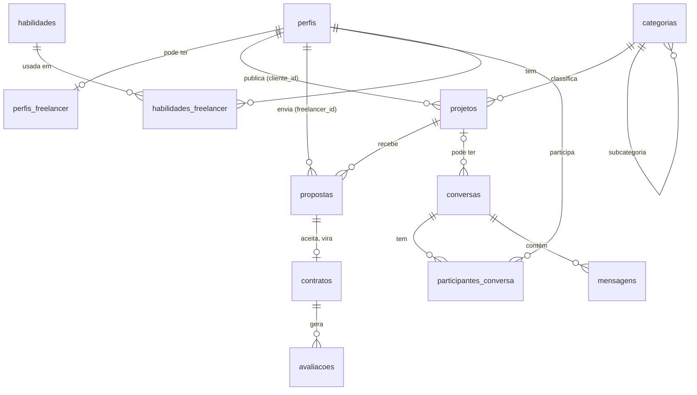

# Banco de dados do FreelanTCHÊ

Estrutura lida direto do Supabase em 29/10/2026, conferida de novo em 11/11/2026 e com conferências pontuais em 15/11/2026.

O banco tem **30 tabelas** no schema `public` e **2 buckets** de arquivos no Storage (veja "Arquivos (Storage)"). Em 11/11, só `projetos` (4 linhas) e `perfis` (1 linha, `usuario_teste`) tinham dados. Em 15/11, `categorias` tinha as 10 categorias do script `03`, e todas as contas do login (Supabase Auth) tinham perfil, criado pelo script `11`.

## Arquivos desta pasta

| Arquivo | O que faz | Já está no Supabase? |
|---|---|---|
| `01_schema.sql` | Criação das tabelas | Vazio. Por enquanto, este documento é o registro da estrutura |
| `02_politicas.sql` | Liga o RLS e cria as regras de acesso | Sim. Copiado do banco; serve para recriar do zero |
| `03_dados_teste.sql` | Categorias de serviço | Sim (10 categorias em 15/11) |
| `04` a `09` | Correções de segurança | Sim (conferido em 11/11) |
| `10_adiciona_local_projetos.sql` | Coluna `localizacao` em `projetos` | Sim |
| `11_cria_perfil_no_cadastro.sql` | Cria o perfil quando alguém se cadastra | Sim |
| `12_cria_bucket_curriculo.sql` | Bucket `curriculo` no Storage (público, PDF ou Word, até 5 MB) e suas regras | Sim |
| `13_adiciona_curriculo_perfis_freelancer.sql` | Coluna `url_curriculo` em `perfis_freelancer` | Sim. Criada pelo painel; o script é o registro |
| `14_cria_bucket_avatares.sql` | Bucket `avatares` no Storage (foto de perfil) e suas regras | Sim. Copiado do banco; o script é o registro |

Para recriar o banco do zero, rode na ordem: `01`, `02`, `04` a `14` e por fim `03`.

## As 30 tabelas em 7 grupos

| Grupo | Tabelas | Para que serve |
|---|---|---|
| Usuários | `perfis`, `perfis_freelancer`, `habilidades`, `habilidades_freelancer`, `itens_portfolio` | Conta, tipo de usuário, perfil profissional, habilidades e portfólio |
| Vagas | `categorias`, `projetos`, `habilidades_projeto`, `favoritos` | O cliente publica um projeto numa categoria; o freelancer pode favoritar |
| Negociação | `propostas`, `contratos`, `marcos`, `avaliacoes` | Proposta aceita vira contrato, o contrato tem etapas e no fim os dois se avaliam |
| Dinheiro | `carteiras`, `transacoes`, `planos`, `assinaturas` | Saldo, pagamentos, saques e planos pagos |
| Chat | `conversas`, `participantes_conversa`, `mensagens` | Conversas entre usuários, que podem estar ligadas a um projeto |
| Suporte e moderação | `tickets_suporte`, `disputas`, `denuncias`, `logs_auditoria` | Chamados, disputas sobre contratos, denúncias e histórico de ações |
| Extras | `notificacoes`, `anexos`, `emblemas`, `emblemas_usuario`, `equipes`, `membros_equipe` | Avisos, arquivos, conquistas e times de freelancers |

## O caminho principal

1. O **cliente** publica um `projeto`, que nasce com status `aberto`.
2. O **freelancer** manda uma `proposta` com valor, prazo em dias e carta de apresentação.
3. O cliente aceita a proposta, e ela vira um `contrato`.
4. O contrato pode ser dividido em `marcos`: etapas com valor e data de entrega.
5. Cada etapa paga gera uma `transacao`, e o saldo vai para a `carteira` do freelancer.
6. No fim, cliente e freelancer deixam uma `avaliacao` um do outro. Se der problema, alguém abre uma `disputa`.

## Núcleo para a entrega

A proposta do trabalho pede cadastro, vagas, pesquisa por categoria, avaliação e chat. Isso cabe em 11 tabelas. As outras podem ficar no banco sem uso por enquanto.



### Colunas do núcleo

`*` = obrigatória. Todo `id` é `uuid` gerado sozinho, e todo `criado_em` recebe a data e a hora na criação.

**perfis**: um por usuário, com o mesmo `id` do login (Supabase Auth).

| Coluna | Tipo | Observação |
|---|---|---|
| `id`* | uuid | Mesmo id do usuário em `auth.users` |
| `tipo_usuario`* | `freelancer`, `cliente` ou `admin` | Padrão `cliente`. Só o servidor muda (script 04). O site não usa (veja "Para quem faz o login") |
| `nome_completo`* | text | |
| `nome_usuario`, `url_avatar`, `bio`, `localizacao`, `pais` | text | |
| `telefone` | text | Escondido da leitura pública (script 05) |
| `verificado` | boolean | Padrão `false`. Só o servidor muda (script 04) |
| `atualizado_em`* | timestamp | Não se atualiza sozinho (não há gatilho) |

**perfis_freelancer**: dados extras de quem trabalha como freelancer.

| Coluna | Tipo | Observação |
|---|---|---|
| `perfil_id`* | uuid → `perfis.id` | Um por perfil |
| `titulo`, `disponibilidade`, `nivel_experiencia` | text | |
| `valor_hora` | numeric | |
| `idiomas` | jsonb | |
| `avaliacao_media`, `total_ganho`, `trabalhos_concluidos` | numeric / integer | Começam em 0. Só o servidor muda (script 07) |
| `url_curriculo` | text | Link do currículo no bucket `curriculo`. Adicionada depois (script 13) |

**categorias**: `nome`*, `slug`*, `icone` e `categoria_pai_id` (→ `categorias.id`), que permite subcategorias.

**projetos**: o "post" da tela de posts.

| Coluna | Tipo | Observação |
|---|---|---|
| `cliente_id`* | uuid → `perfis.id` | Quem publicou |
| `categoria_id` | uuid → `categorias.id` | |
| `titulo`*, `descricao`* | text | |
| `tipo_orcamento`* | `fixo` ou `por_hora` | Padrão `fixo` |
| `orcamento_min`, `orcamento_max` | numeric | |
| `prazo` | date | |
| `localizacao` | text | Adicionada depois; bate com o campo "Local" da tela |
| `status`* | `aberto`, `em_andamento`, `concluido` ou `cancelado` | Padrão `aberto` |

Os campos da tela de posts se encaixam assim: tipo do serviço vai para `titulo`, valor vai para `orcamento_min` e `orcamento_max`, local vai para `localizacao` e descrição vai para `descricao`.

**propostas**

| Coluna | Tipo | Observação |
|---|---|---|
| `projeto_id`* | uuid → `projetos.id` | |
| `freelancer_id`* | uuid → `perfis.id` | Quem enviou |
| `valor_proposto`* | numeric | |
| `prazo_estimado_dias` | integer | |
| `carta_apresentacao` | text | |
| `status`* | `pendente`, `aceita`, `rejeitada` ou `retirada` | Padrão `pendente` |

**contratos**: `projeto_id`*, `proposta_id`, `cliente_id`*, `freelancer_id`*, `valor_total`*, `status`* (`ativo`, `concluido`, `cancelado` ou `em_disputa`; padrão `ativo`), `data_inicio` (padrão: hoje) e `data_fim`.

**avaliacoes**: `contrato_id`*, `avaliador_id`*, `avaliado_id`*, `nota`* (integer) e `comentario`. Só existe avaliação ligada a um contrato.

**conversas**: `projeto_id` (opcional). **participantes_conversa**: `conversa_id` + `usuario_id`. **mensagens**: `conversa_id`*, `remetente_id`*, `conteudo`, `url_anexo` e `lido_em`.

**habilidades**: `nome`*, `slug`*. **habilidades_freelancer**: `freelancer_id` + `habilidade_id` + `nivel`. **habilidades_projeto**: `projeto_id` + `habilidade_id`.

### Colunas das outras tabelas

| Tabela | Colunas principais |
|---|---|
| `itens_portfolio` | `freelancer_id`*, `titulo`*, `descricao`, `url_imagem`, `url_projeto` |
| `favoritos` | `usuario_id` + `projeto_id` |
| `marcos` | `contrato_id`*, `titulo`*, `descricao`, `valor`*, `data_entrega`, `status`* (`pendente`, `em_andamento`, `enviado`, `aprovado`, `pago`) |
| `carteiras` | `usuario_id` (um por usuário), `saldo`, `saldo_pendente`, `moeda` (padrão `BRL`) |
| `transacoes` | `contrato_id`, `marco_id`, `usuario_origem`, `usuario_destino`, `valor`*, `taxa`, `tipo` (`pagamento`, `saque`, `reembolso`, `deposito`, `taxa`), `status` (`pendente`, `concluida`, `falhou`, `cancelada`) |
| `planos` | `nome`*, `preco`*, `periodo_cobranca`, `recursos` (jsonb), `max_propostas_mes` |
| `assinaturas` | `usuario_id`*, `plano_id`*, `status` (padrão `ativa`), `fim_periodo_atual` |
| `tickets_suporte` | `usuario_id`*, `assunto`*, `descricao`, `status`* (padrão `aberto`; `aberto`, `em_andamento`, `resolvido`, `fechado`) |
| `disputas` | `contrato_id`*, `aberta_por`*, `motivo`*, `status` (`aberta`, `em_analise`, `resolvida`, `fechada`), `resolucao`, `resolvida_em` |
| `denuncias` | `denunciante_id`*, `usuario_denunciado_id`*, `motivo`*, `status` (padrão `pendente`) |
| `logs_auditoria` | `usuario_id`, `acao`*, `tipo_entidade`, `id_entidade`, `metadados` (jsonb) |
| `notificacoes` | `usuario_id`*, `tipo`* (`mensagem`, `proposta`, `contrato`, `pagamento`, `avaliacao`, `sistema`), `titulo`*, `conteudo`, `link`, `lida` |
| `anexos` | `tipo_relacionado`*, `id_relacionado`*, `url_arquivo`*, `nome_arquivo`, `tamanho_arquivo`, `enviado_por` |
| `emblemas` | `nome`*, `descricao`, `icone`, `criterio` (jsonb) |
| `emblemas_usuario` | `usuario_id` + `emblema_id`, `concedido_em` |
| `equipes` | `nome`*, `dono_id`* |
| `membros_equipe` | `equipe_id` + `usuario_id`, `papel` (padrão `membro`) |

## Quem pode o quê

As regras de linha (RLS) ficam no próprio banco. "Só o servidor" quer dizer que a operação só funciona com a chave secreta (`supabaseAdmin` no backend), porque nenhuma regra libera para o usuário.

| Tabela | Quem lê | Quem escreve |
|---|---|---|
| `perfis` | Todos, menos a coluna `telefone` | O dono edita os dados pessoais. Criar: o próprio banco, no cadastro (script 11) |
| `perfis_freelancer` | Todos | O dono cria e edita os campos descritivos; os números só o servidor |
| `categorias`, `habilidades`, `habilidades_projeto`, `planos`, `emblemas`, `emblemas_usuario` | Todos | Só o servidor |
| `habilidades_freelancer`, `itens_portfolio` | Todos | O dono gerencia os seus |
| `projetos` | Todos | O cliente cria em nome próprio e edita os seus. Apagar: ninguém |
| `favoritos` | O dono | O dono gerencia os seus |
| `propostas` | O freelancer que enviou e o cliente dono do projeto | O freelancer cria (pendente, projeto aberto de outra pessoa). **Aceitar, recusar ou retirar: só o servidor** |
| `contratos` | O cliente e o freelancer do contrato | Só o servidor |
| `avaliacoes` | Todos | Só o servidor |
| `conversas`, `participantes_conversa` | Quem participa | Só o servidor (abrir conversa) |
| `mensagens` | Quem participa | O participante envia em nome próprio. Marcar como lida: só o servidor |
| `notificacoes`, `carteiras`, `assinaturas` | O dono | Só o servidor |
| `transacoes` | Quem pagou e quem recebeu | Só o servidor |
| `tickets_suporte` | O dono | O dono abre como `aberto`; o resto, só o servidor |
| `anexos`, `denuncias`, `disputas`, `equipes`, `logs_auditoria`, `marcos`, `membros_equipe` | Só o servidor | Só o servidor (RLS ligado e nenhuma regra) |

Na prática, estas ações precisam de uma rota no backend que use a chave secreta e confira as permissões no código:

- **Aceitar uma proposta**: muda a proposta para `aceita`, cria o `contrato` e passa o projeto para `em_andamento`.
- **Avaliar**: cria a `avaliacao` e recalcula `avaliacao_media` do freelancer.
- **Abrir uma conversa**: cria a `conversa` e os dois `participantes_conversa`.

## Arquivos (Storage)

Os dois buckets são **públicos**: qualquer pessoa com o link abre o arquivo. Para enviar ou trocar, é preciso estar logado, e cada usuário só mexe na pasta com o próprio id. O site salva como `<id do usuário>/<arquivo>`, e arquivo fora dessa pasta é bloqueado. Ninguém apaga arquivo, porque não há regra de DELETE; para trocar, o site envia de novo com o mesmo nome (`upsert`).

| Bucket | Para quê | Aceita | Limite | Script |
|---|---|---|---|---|
| `avatares` | Foto de perfil (`perfis.url_avatar`) | JPG, PNG, WebP | 2 MB | `14` |
| `curriculo` | Currículo do freelancer (`perfis_freelancer.url_curriculo`) | PDF, DOC, DOCX | 5 MB | `12` |

## Gatilhos

Na leitura de 29/10 não existia nenhum gatilho nas tabelas do projeto nem em `auth.users`. Os únicos eram internos do Supabase (`realtime` e `storage`). O script `11` cria o primeiro, que gera o perfil no cadastro. Continua valendo que:

- `atualizado_em` **não** muda sozinho quando uma linha é editada;
- `avaliacao_media`, `total_ganho` e `trabalhos_concluidos` **não** são recalculados sozinhos.

## Para quem faz o login

Depois do script `11`, o cadastro cria o perfil sozinho, usando o que o `signUp` manda em `options.data`. O `auth.js` do site já manda o nome:

```js
options: { data: { nome_completo: nome } }
```

Sem `nome_completo`, o banco usa a parte do e-mail antes do `@`.

O grupo decidiu que a mesma conta serve para contratar e para prestar serviço: a modalidade fica só no navegador (`localStorage`) e não vai para o banco. Por isso o site não manda `tipo_usuario`, e todo perfil nasce `cliente`. Isso não quebra nada, porque nenhuma regra do banco olha `tipo_usuario`. Para saber se alguém trabalha como freelancer, confira se ele tem uma linha em `perfis_freelancer`.

Se um dia quiserem mandar o tipo, o gatilho aceita `tipo_usuario: 'freelancer'`. Qualquer outro valor, inclusive `admin`, vira `cliente`.

## Problemas

1. **7 tabelas sem nenhuma regra:** `anexos`, `denuncias`, `disputas`, `equipes`, `logs_auditoria`, `marcos` e `membros_equipe`. O RLS está ligado nas 30 tabelas, então essas ficam fechadas para os usuários e só o servidor acessa. Isso é seguro. Se o front-end precisar delas um dia, vai precisar de regras novas ou de rotas no backend.

## Consultas para atualizar este documento

Rode no SQL Editor do Supabase:

```sql
-- RLS ligado em cada tabela?
select c.relname as tabela, c.relrowsecurity as rls_ligado
from pg_class c
where c.relnamespace = 'public'::regnamespace and c.relkind = 'r'
order by 1;

-- Regras de acesso
select tablename, policyname, cmd, roles, qual, with_check
from pg_policies where schemaname = 'public' order by tablename, cmd;

-- Gatilhos
select tgrelid::regclass as tabela, tgname as gatilho, pg_get_triggerdef(oid) as definicao
from pg_trigger where not tgisinternal order by 1;

-- Buckets do Storage
select id, public, file_size_limit, allowed_mime_types from storage.buckets order by id;

-- Regras dos arquivos (Storage)
select policyname, cmd, roles, qual, with_check
from pg_policies where schemaname = 'storage' and tablename = 'objects' order by policyname;
```
